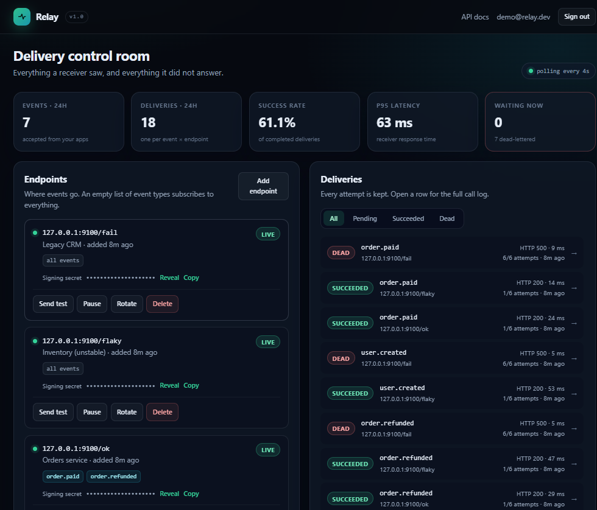

# Relay

**Signed webhook delivery with retries, per-attempt logs, and replay.**

A webhook delivery service: your app posts an event once, Relay fans it out to
every subscribed endpoint, signs each request, retries failures on an
exponential backoff, and keeps a record of every attempt so a failure can be
diagnosed instead of guessed at.



Status: **complete and tested locally, not deployed.** The backend suite covers
signing, retry policy, fan-out, auth and the worker; the frontend builds clean.
There is no hosted demo, because the worker needs a long-running process and I
have not paid for one.

---

## Why this project

The other apps in my portfolio are request/response: a user clicks, a handler
runs, a row changes. This one is about what happens when the receiver is not
there. That means background work, retry state that survives a restart, and the
question I found most interesting — *what does a failed delivery mean?*

A timeout has no status code. A 500 has a body worth keeping. A 302 looks like
a success if you follow redirects blindly, and then your payload is POSTed to a
URL the endpoint owner never configured. Relay treats each of those as distinct
outcomes and logs them that way.

---

## What it does

- **Fan-out on ingest.** One event creates one delivery per subscribed endpoint.
  An empty subscription list means every event type.
- **Signed requests.** Every delivery carries `X-Relay-Signature:
  t=<unix>,v1=<hmac>`, computed over `<timestamp>.<raw body>` with the endpoint's
  own secret.
- **Exponential backoff with jitter.** 5s, 10s, 20s, 40s … capped at 15 minutes,
  ±15% jitter, six attempts by default.
- **A full attempt log.** Each HTTP call is stored with outcome, status code,
  response excerpt, error text, latency and timestamp. Earlier attempts are
  never overwritten.
- **Dead-lettering.** After the final attempt a delivery moves to `dead` instead
  of disappearing or retrying forever.
- **Replay.** Sends a terminal delivery again as a *new* delivery, so the
  original failure stays in the history.
- **Crash recovery.** Claimed rows hold a short lease; a process that dies
  mid-flight leaves work that becomes due again instead of vanishing.
- **Two auth paths.** JWT for the dashboard, hashed API keys (`X-API-Key`) for
  machine ingestion. API keys are shown once and revocable.
- **Endpoint controls.** Pause/resume, rotate signing secret, send a test event,
  subscribe to specific event types.

---

## Architecture

```
POST /api/ingest ──► events row ──► one delivery row per matching endpoint
                                              │
                                              ▼
                                     worker claims due rows
                                     (lease + FOR UPDATE SKIP LOCKED
                                      on PostgreSQL)
                                              │
                            ┌─────────────────┼─────────────────┐
                            ▼                 ▼                 ▼
                        signed POST       signed POST       signed POST
                            │                 │                 │
                            └──────────► attempt rows ◄─────────┘
                                              │
                        2xx ──► succeeded    │    otherwise ──► pending + backoff
                                              │                 or dead after max
```

The worker runs in the API process by default (`RUN_WORKER=true`), which keeps
local setup to one command. It can be moved to its own process by running the
API with `RUN_WORKER=false` and starting a worker separately — the claim query
is designed so multiple PostgreSQL workers can share the table.

### Retry policy

| Attempt | Delay before it (base 5s) |
| --- | --- |
| 1 | immediately |
| 2 | ~5s |
| 3 | ~10s |
| 4 | ~20s |
| 5 | ~40s |
| 6 | ~80s |
| after 6 | `dead`, no further attempts |

Delay is `min(base × 2^(n-1), RETRY_MAX_SECONDS)` with ±15% jitter. Jitter
matters when a receiver comes back online: without it, every queued delivery
retries in the same second.

---

## Verifying a signature

The signature is over the **raw request bytes**. Do not parse the JSON and
re-serialise it before verifying — key order and whitespace are part of what was
signed.

```python
import hashlib, hmac, time

def verify(secret: str, header: str, body: bytes, tolerance: int = 300) -> bool:
    parts = dict(part.split("=", 1) for part in header.split(","))
    timestamp = int(parts["t"])
    if abs(time.time() - timestamp) > tolerance:
        return False
    expected = hmac.new(
        secret.encode(), f"{timestamp}.".encode() + body, hashlib.sha256
    ).hexdigest()
    return hmac.compare_digest(expected, parts["v1"])
```

The timestamp check is what stops an old request from being replayed at your
receiver. Relay's own tests cover a tampered body, the wrong secret, an expired
timestamp and a malformed header.

---

## Run it locally

### 1. API

```bash
cd backend
python -m venv .venv
.venv\Scripts\activate          # macOS/Linux: source .venv/bin/activate
pip install -r requirements-dev.txt
uvicorn app.main:app --reload
```

- API: <http://localhost:8000>
- Swagger: <http://localhost:8000/docs>
- SQLite database: `backend/relay.db` (created on first run)

### 2. Dashboard

```bash
cd frontend
npm install
npm run dev
```

<http://localhost:5173> — register with any email and a password of at least 10
characters. The first API key is shown once, right after registration.

### 3. A receiver to point at

```bash
cd backend
python scripts/demo_receiver.py
```

Routes `http://127.0.0.1:9100/ok`, `/flaky`, `/fail`, `/slow`. Then:

```bash
python scripts/seed_demo.py
```

This creates the `demo@relay.dev` account, three endpoints and a handful of
events. After ~20 seconds the dashboard shows one endpoint that recovered on
retry, one that succeeds immediately, and one that dead-letters.

---

## Tests

```bash
cd backend
python -m pytest
```

31 tests, no network access required. `httpx.MockTransport` stands in for
receivers, so the worker tests exercise the real retry, signing and persistence
paths without hitting the internet.

Covered:

- signature round-trip, tampering, wrong secret, replay window, malformed header
- backoff sequence, cap, jitter bounds
- registration, login, duplicate email, JWT rejection
- per-user isolation (another user's endpoint id returns 404, not 403)
- fan-out filtering by event type and pause state
- API key creation, listing prefixes, revocation
- worker retry → success, dead-letter after max attempts, network errors,
  redirects not followed, replay creating a new row

---

## API

| Method | Path | Auth | Purpose |
| --- | --- | --- | --- |
| POST | `/api/auth/register` | — | Create account, returns JWT + first API key |
| POST | `/api/auth/login` | — | JWT |
| GET | `/api/auth/me` | JWT | Current user |
| GET/POST | `/api/keys` | JWT | List prefixes / create key |
| DELETE | `/api/keys/{id}` | JWT | Revoke |
| GET/POST | `/api/endpoints` | JWT | List / create |
| PATCH/DELETE | `/api/endpoints/{id}` | JWT | Update / delete |
| POST | `/api/endpoints/{id}/rotate-secret` | JWT | New signing secret |
| POST | `/api/endpoints/{id}/test` | JWT | Queue a test event |
| POST | `/api/events` | JWT | Send an event |
| POST | `/api/ingest` | API key | Machine ingestion |
| GET | `/api/events` | JWT | Recent events with delivery counts |
| GET | `/api/events/{id}` | JWT | Event + its deliveries |
| GET | `/api/deliveries` | JWT | Filter by status/event/endpoint |
| GET | `/api/deliveries/{id}` | JWT | Delivery + attempt log |
| POST | `/api/deliveries/{id}/replay` | JWT | Replay as a new delivery |
| GET | `/api/stats` | JWT | Counts, success rate, p95 latency |

Ingesting:

```bash
curl -X POST http://localhost:8000/api/ingest \
  -H "X-API-Key: relay_live_..." \
  -H "Content-Type: application/json" \
  -d '{"type":"order.paid","payload":{"order_id":"ord_1","amount":499}}'
```

---

## Docker

```bash
copy .env.example .env       # macOS/Linux: cp
docker compose up --build
```

- Dashboard: <http://localhost:8080>
- API: <http://localhost:8000>

PostgreSQL 16, the API and an nginx-served dashboard. The database volume
survives restarts. Change `POSTGRES_PASSWORD` and `JWT_SECRET` before putting
this anywhere real.

---

## Decisions worth explaining

**Hashed API keys, plaintext signing secrets.** Ingestion keys only need to be
compared, so only a SHA-256 hash is stored and the full key is shown once.
Signing secrets have to be available to sign every request, so they are stored
in plaintext — the same trade-off Stripe makes. Rotating one is a single
endpoint and immediately invalidates the old value.

**The signature covers the timestamp.** Signing only the body would let anyone
who captured one request replay it forever. The receiver's tolerance window is
what makes the timestamp useful; the service cannot enforce it from its side.

**A replay is a new delivery.** Resetting the original would erase the record
that made the failure worth investigating.

**Timestamps are naive UTC.** SQLite has no timezone-aware datetime type. Mixing
aware and naive values across SQLite and PostgreSQL is a reliable source of
off-by-hours bugs, so UTC-everywhere is enforced at the database boundary. (One
of the tests checks that a signature generated from a stored attempt timestamp
still verifies, which is exactly where that bug would show up.)

**Redirects are failures.** `follow_redirects=False`. A 3xx is recorded as an
HTTP error and retried, rather than silently sending the payload somewhere the
endpoint owner did not configure.

---

## Not built yet

Listed so the feature list above is not read as more than it exists.

- **No hosted demo.** The frontend and backend run locally or in Docker only.
- **No Alembic migrations.** The schema is created with `create_all`, which adds
  missing tables but never alters existing columns. Adding a column to an
  existing `relay.db` means deleting it. Alembic is the next infrastructure task.
- **No rate limiting on `/api/ingest`.** A leaked key can push events as fast as
  the network allows. Per-key token buckets are the next security task.
- **No egress filtering.** An endpoint URL may point at a private address. A
  hosted version would need an allowlist/denylist for SSRF protection.
- **No frontend tests.** The React dashboard has no test suite; the backend is
  where the behaviour worth testing lives.
- **One worker per SQLite database.** PostgreSQL claims use
  `FOR UPDATE SKIP LOCKED`; SQLite has no equivalent, so running several workers
  against one SQLite file can duplicate a delivery. Documented rather than
  silently mishandled.
- **No automatic disabling of consistently dead endpoints.** A permanently
  broken receiver stays subscribed and keeps collecting deliveries.

---

## Layout

```
webhook-relay/
├── backend/
│   ├── app/
│   │   ├── main.py         app factory, lifespan, worker startup
│   │   ├── config.py       env-backed settings
│   │   ├── models.py       users, keys, endpoints, events, deliveries, attempts
│   │   ├── signing.py      HMAC signing and verification
│   │   ├── delivery.py     one attempt + retry decision
│   │   ├── worker.py       claim, send concurrently, recover leases
│   │   ├── service.py      event fan-out
│   │   └── routers/        auth, keys, endpoints, events, deliveries
│   ├── scripts/            demo receiver + demo seed
│   └── tests/              31 pytest tests
├── frontend/
│   └── src/
│       ├── App.tsx         auth, polling, state
│       └── components/     endpoints, composer, deliveries, drawer, keys
├── docker-compose.yml
└── docs/dashboard.png
```

---

## Licence

MIT — see the repository root.
